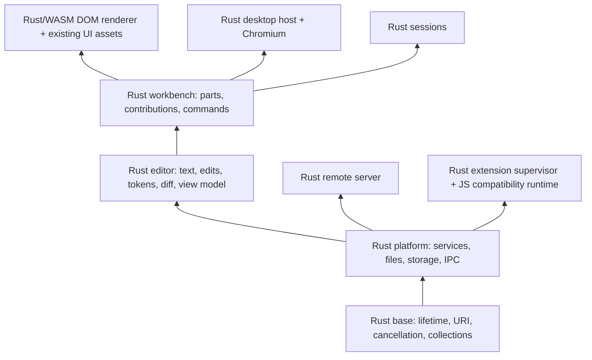

# Rust Editor Architecture

## Status and objective

The objective is to migrate all first-party editor implementation to Rust, improve measured performance and resource consumption, and preserve the existing Code OSS interface and behavior. The current workspace implements the first text-storage boundary. This document describes the complete migration, not a completed Rust application.

The reference checkout is `1b0463d1793` on `main`, Code OSS `1.146.0`, with Electron `43.8.6`. Capture baselines against an unmodified checkout of this revision using isolated profiles. Keep the same OS, Chromium revision, display scale, fonts, theme, locale, extensions, workspace, and fixture data for each comparison.

## Rendering decision

Retain the existing Electron/Chromium shell throughout the initial migration. Keep all existing DOM structures, CSS, codicons, fonts, themes, localization resources, layout rules, accessibility roles, and event behavior. Replace the implementation behind service and model boundaries before replacing the code that constructs the UI.

Tauri 2 is not the baseline shell. Its default WebView uses WebView2 on Windows and WebKit-based engines on macOS and Linux. Different engines can change text metrics, wrapping, composition, CSS behavior, accessibility, and rendering. Lower shell overhead alone does not satisfy exact interface parity or prove lower whole-application memory use.

The target shell is a Rust host embedding Chromium, with CEF as the candidate embedding layer. CEF is a feasibility decision, not an implemented dependency. Before selecting a binding, prove sandboxing, compositor behavior, IME, native menus, window management, accessibility, drag and drop, webviews, DevTools, update/security policy, and packaging on all supported desktop platforms. If the candidate fails these gates, retain Electron while evaluating another Chromium embedding approach. Never replace the shell solely to claim a Rust rewrite.

The final editor and workbench UI implementation can compile from Rust to WebAssembly and construct the same DOM through generated bindings. HTML, CSS, fonts, grammar assets, and localized resources remain product assets. Minimal generated JavaScript is an ABI bridge; it must not become a second handwritten editor implementation. Third-party JavaScript extensions remain external compatibility consumers and do not have to be rewritten by their users.

## Layers

Preserve the repository's dependency direction: `base` to `platform` to `editor` to `workbench`. Desktop and server hosts depend on these layers. Sessions may depend on workbench; workbench must not depend on sessions.

Only `vscode-editor-core` and `vscode-editor-wasm` exist today. Add the following crates when their first real subsystem is migrated; do not create empty crates or stub services:

| Planned crate | Existing source boundary | Responsibility |
| --- | --- | --- |
| `vscode-base` | `src/vs/base/` | URI semantics, events, lifetimes, cancellation, collections, binary buffers, platform-independent primitives |
| `vscode-platform` | `src/vs/platform/` | Service interfaces, command/contribution registries, file providers, storage, configuration, workspace identity, IPC |
| `vscode-editor-core` | `src/vs/editor/common/` | Text storage, model state, edits, selections, decorations, undo, diff, tokenization, brackets, folding, search |
| `vscode-editor-wasm` | Editor browser ABI | Same core compiled for renderer and web/worker contexts |
| `vscode-workbench` | `src/vs/workbench/` | Layout state, editor groups, parts, actions, contribution points, service orchestration |
| `vscode-dom` | `src/vs/base/browser/`, `src/vs/editor/browser/`, workbench browser parts | Rust/WASM construction of the unchanged DOM and accessibility tree |
| `vscode-desktop` | `src/vs/code/`, Electron-specific platform/workbench services | OS integration, window management, Chromium embedding, lifecycle, crash recovery, updates |
| `vscode-server` | `src/vs/server/`, remote platform services | Remote file/service transport, authentication, reconnection, workspace and extension management |
| `vscode-extension-host` | `src/vs/workbench/api/` and extension services | Rust API implementation, activation, isolation, extension process supervision, runtime compatibility |
| `vscode-sessions` | `src/vs/sessions/` | Sessions workbench without introducing reverse imports into workbench |

Built-in extensions migrate through their existing contribution and API contracts. Language servers and debug adapters retain LSP/DAP compatibility whether their implementation is Rust or an independently maintained external dependency.

## Process and ownership model

- Keep synchronous, latency-sensitive model operations in the renderer's WebAssembly instance. Do not put each keystroke behind an asynchronous desktop IPC round trip.
- Put filesystem I/O, watchers, search/indexing, terminal PTYs, persistent storage, OS integration, and remote networking in native Rust services. Use bounded work queues, cancellation, and explicit ownership for every process, task, and watcher.
- Use one immutable document version per model revision and share it for save, diff, tokenization, and background readers where transport permits. Send incremental edits and version IDs to worker and remote replicas; avoid broadcasting complete document contents for each change.
- Retain an isolated JavaScript/Node runtime for existing extensions, language servers, debug adapters, and notebook renderers that require it. A Rust supervisor owns activation, cancellation, crash isolation, shutdown, and IPC. Removing the first-party TypeScript host implementation does not remove the ecosystem's runtime requirements.
- Preserve extension failure isolation and workspace trust enforcement. Never load arbitrary extension code into a privileged Rust desktop process to reduce the process count.

## Service contracts and transport

Keep service interfaces and contribution registries aligned with their TypeScript counterparts during migration. Use explicit constructor dependencies in adapters and composition roots in Rust. Prefer direct service calls for control flow and events for state changes. Rust resources use ownership, `Drop`, and scoped guards; bridges implement the existing `IDisposable` contracts.

Define versioned, typed messages for migrated process boundaries. Each request carries a request ID, operation, model/workspace identifier when applicable, document version, cancellation token identity, and a typed result or error. Validate input lengths and identifiers before processing. Return stale-version results as explicit conflicts instead of applying them to newer documents.

Do not introduce a second message protocol before a real native service requires one. During coexistence, adapt existing channels instead of replacing all IPC at once. Preserve remote capability negotiation, reconnect semantics, extension API serializers, URI normalization, and existing error codes. Generated bindings and schema compatibility checks are part of each boundary's build.

## Text contract

Positions remain one-based; offsets remain zero-based UTF-16 code units. A Rust `String` byte offset is not an editor offset. Preserve lone surrogate code units, CR, LF, CRLF, cross-chunk CRLF, BOM, RTL flags, and unusual line terminators. File decoding/encoding stays at the existing boundary until that service migrates.

The implemented core is a persistent AVL rope with leaves bounded to 1,024 code units. Latin-1 leaf payloads use one byte per code unit; other leaves retain UTF-16. Split views share an immutable payload and line-ending index, including splits inside CRLF. Each node caches length and line-ending counts. Combining summaries accounts for CRLF split across children. Replacement splits and joins shared trees; whole-document and range snapshots retain an immutable version with lazy, sequential traversal. Native batch edits validate all original ranges, assemble unchanged ranges and inserted leaves in input order while advancing through the original tail, and commit the root once. No handwritten unsafe Rust is permitted by workspace lint policy.

The current adapter replaces storage beneath `PieceTreeTextBuffer`. It retains the existing edit validation, reverse edit generation, whitespace handling, events, model versioning, and undo service. Validated batches use one typed binding call with original UTF-16 ranges and packed text slices; Rust checks every tuple and range before committing the shared-tree update. Equal-offset insertions preserve the existing sort order, and a single edit uses one replacement. Storage ABI 3 rejects bindings without this batch contract at initialization. The adapter explicitly frees model bindings on disposal and snapshot bindings at stream exhaustion. The default buffer path and its implementation-specific tests remain available.

The adapter detects consecutive line reads and prefetches one cache of up to 64 lines and 32,768 code units; isolated reads copy one line directly, and the first line may exceed that budget so long lines are never truncated. UTF-8 bindings transfer surrogate-free input and ASCII output. Other output uses lossless UTF-16 typed arrays and native JavaScript decoding, with explicit handling of sparse or dense lone surrogates. This avoids transcoding non-ASCII text to UTF-8 and back. Plain literal search scans Rust leaf views with KMP and compact-leaf `memchr` skipping, without decoding each line. Case folding, word classification, captures, regular expressions, and multiline search retain their existing compatibility implementation.

Before promoting this implementation, measure persistent-node and shared-index overhead, ASCII/Latin-1/Unicode storage, leaf sizing, fragmented editing, random and sequential line reads, save/snapshot cost, and string conversion across the WebAssembly boundary. Compact payload size alone does not establish application resource savings. Worker, browser, packaging, and cross-platform gates remain required.

Editor worker mirrors use the registered Rust storage without retaining a second decoded line array or prefix-sum index. Model events replay sequentially, normalize inserted line endings, and preserve the existing mirror coordinate and version contracts. Nonstandard line arrays or EOL values retain the original path. Worker model removal, replacement, and disposal explicitly free storage. The renderer passes generated asset locations to isolated workers before synchronization; load failure retains the existing implementation, and synchronous fallback reuses the renderer registration. Node worker and Chromium fixtures exercise the actual protocol and browser bootstrap, including initialization failure and late disposal. Extension-host and TextMate mirrors and full web startup remain separate migration boundaries.

## Migration sequence

The advanced diff pipeline delegates weighted line and unweighted character alignment to Rust dynamic programming and Myers algorithms. Dynamic programming uses byte directions and one rolling score/run-length row. Myers uses separate growing diagonal sides and an indexed path arena, preserving the original typed-frontier number semantics and path preferences. Typed boundaries preserve numeric equality, UTF-16 offsets, and half-open ranges. Sequence ABI 3 includes native deadline checks; `DateTimeout` exposes its millisecond deadline and latches native expiration, while overridden/custom timeout checks remain callbacks. Allocation limits preserve the existing fallback rather than introducing a new visible error. Existing diff heuristics, move detection, and range translation remain migration work.

| Stage | Scope | Required result before advancing | Current status |
| --- | --- | --- | --- |
| 0 | Baselines, architecture, toolchain, formatting, validation commands | Reproducible native/WASM builds and explicit compatibility gates | Architecture and build/test foundation implemented; complete application baselines pending |
| 1 | Text storage | Differential tests against real buffer/model operations, resource lifetime checks, workload benchmarks, worker/web parity | Desktop and editor worker storage implemented behind an internal flag; Node/Chromium worker parity checked; full web, packaging, and promotion gates pending |
| 2 | Remaining editor model | Undo/redo, edits, selections, decorations, search, diff, bracket/folding state, tokens, Unicode behavior ported with existing contracts | Literal search, model batch application, weighted dynamic diff, and Myers alignment implemented; remaining model/diff algorithms planned |
| 3 | Native platform services | Files/encoding/watchers, workspace search, storage/configuration, process management, clipboard, dialogs, trust, lifecycle migrated individually | Planned |
| 4 | Terminal and development tools | PTY/ConPTY, shell integration, terminal state, tasks, Git/SCM, LSP/DAP, debug sessions, diagnostics retain behavior | Planned |
| 5 | Extensions and rich editors | Extension API and built-in contributions, webviews, notebook models/renderers, custom editors, authentication, synchronization retain contracts | Planned |
| 6 | Rust DOM editor/workbench | Editor rendering, lists/trees, panels, groups, menus, widgets, accessibility and input ported without changing DOM/assets | Planned |
| 7 | Rust desktop/server/sessions | Chromium host, native lifecycle, packaging, remote transport, browser startup and sessions pass platform gates | Planned |
| 8 | Completion | All first-party editor implementation migrated; obsolete adapters removed; supported product variants and ecosystem tests pass | Planned |

Stages overlap only where dependencies allow it. For example, native workspace search can migrate while the remaining editor model is being ported. Do not delete an old subsystem or enable a replacement by default until its functional, visual, security, resource, and platform gates pass. An incomplete substitute with fewer features is not an acceptable migration.

## Compatibility inventory

Every stage updates an inventory of the public and internal contracts it owns. The complete rewrite includes all of the following:

- Editing: multi-cursor, IME/composition, bidirectional text, graphemes, keybindings, snippets, completions, hovers, signature help, rename, code actions, diagnostics, formatting, selection, decorations, folding, minimap, diff/merge, large files, accessibility, and undo/redo.
- Workbench: explorer, quick input, command palette, editor groups, drag and drop, menus, panels, status/activity bars, settings, profiles, themes/icons, localization, notifications, welcome flows, search, workspace trust, and lifecycle restoration.
- Development: terminal, shell integration, tasks, build runners, source control, debugging, test explorer, language services, extension management, and process inspection.
- Documents: file encodings, BOM and EOL, hot exit/backups, untitled documents, custom editors, notebook outputs, webviews, readonly/virtual files, provider capabilities, and save/conflict behavior.
- Distributed features: remote workspaces, server installation, tunnels, reconnect, authentication, settings synchronization, extension placement, browser product variants, and sessions.
- Desktop delivery: operating-system integrations, native/custom title bars, multiple/auxiliary windows, application menus, deep links, updates, sandbox and permissions, signing/installers, crash reporting, supported architectures, and licenses.
- Ecosystem: stable/proposed extension APIs, activation/contribution points, existing built-in extensions, LSP/DAP framing, TextMate grammars/Oniguruma semantics, themes, notebook renderers, debug adapters, and extension-host isolation.

## Acceptance gates

### Functional

Run the existing targeted suites for each migrated boundary against both implementations, plus differential tests over real commands and seeded operation traces. Preserve return values, edit ordering, inverse edits, event order/count, version IDs, error behavior, cancellation, save bytes, and extension API serialization. Promote only after the relevant extension API, integration, smoke, and platform tests pass. Do not replace established tests with tests that only mirror the Rust implementation.

### Visual and interaction

Use isolated profiles and deterministic fixtures. Compare screenshots and accessibility trees on Windows, macOS, and Linux with fixed Chromium, scale, fonts, locale, theme, viewport, caret phase, and animation state. Cover native/custom title bars, menus, dialogs, every workbench part, editor widgets, terminal, notebook/webview surfaces, and sessions. Require identical layout, text wrapping, colors, and assets; investigate rendering differences rather than accepting a visually similar replacement. Verify keyboard navigation, screen readers, pointer input, focus, composition, clipboard, drag and drop, and display-scale changes through interaction tests.

### Performance and resources

Collect cold/warm startup, keystroke-to-paint latency, cursor movement, scrolling, large-file open/save, diff, workspace search, extension activation, terminal output, and idle CPU. Record medians and tail latency, total application process RSS/private bytes, JS heap, WebAssembly linear memory, native allocations, process/thread count, and package size. Include ASCII, non-ASCII, long-line, fragmented-document, many-open-document, notebook, remote, and extension-heavy workloads. Report raw runs, build mode, fixture sizes, and machine/software conditions.

Use the full process tree for application memory comparisons. Reduced JS heap can hide increased WebAssembly/native allocations. A microbenchmark is evidence about that workload only. Select promotion budgets from the captured baseline and do not claim gains until the replacement improves representative resource and latency measurements without sacrificing parity.

### Security and delivery

Preserve sandboxing, workspace trust, extension isolation, URI/path validation, permission handling, credentials storage, resource access restrictions, and update verification. Exercise invalid boundary messages, stale versions, cancelled operations, crashes, shutdown races, and remote reconnect. Build and test supported OS/architecture combinations; retain license notices and reproducible dependency locks.

## Completion definition

The full rewrite is complete only when all first-party editor, workbench, platform, host, server, sessions, and built-in contribution implementations covered by the inventory have migrated, all applicable gates pass, the existing interface and feature set are preserved, and measured resource/performance improvements are documented. Retaining external Chromium, JavaScript extension runtimes, language servers, assets, or system libraries is compatible with a Rust implementation; retaining the first-party TypeScript editor behind a Rust launcher is not completion.
