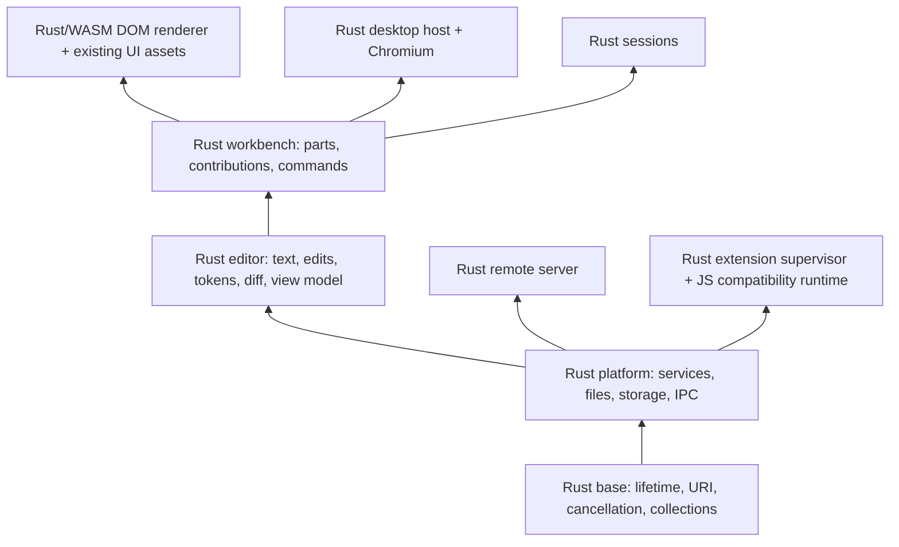

# Rust Editor Architecture

## Status and objective

The objective is to migrate all first-party editor implementation to Rust, improve measured performance and resource consumption, and preserve the existing Code OSS interface and behavior. The current workspace integrates text storage/model transactions, indentation/folding/guides, cursor and Unicode kernels, token processing, decoration endpoint edits, advanced document diff, and open undo storage. This document describes the complete migration, not a completed Rust application.

Phase 1 prioritizes complete functional core migration. Implement and integrate each applicable subsystem, preserve strict behavior, API, and extension compatibility, run its canonical tests, and continue immediately to the next subsystem. Keep the application operational. Correctness defects, critical performance regressions, and memory safety issues are fixed immediately; non-critical regressions and future optimization opportunities are recorded in [Performance](PERFORMANCE.md). Working modules are not repeatedly benchmarked or micro-optimized during this phase. Phase 2 begins only after all targeted core subsystems are integrated, validated, and operational; it profiles and optimizes whole-application behavior under equivalent real-world workloads until remaining opportunities have diminishing returns or unacceptable trade-offs. Performance promotion gates do not turn a functioning Phase 1 subsystem into an indefinite optimization task.

The reference checkout is `1b0463d1793` on `main`, Code OSS `1.146.0`, with Electron `43.8.6`. Capture baselines against an unmodified checkout of this revision using isolated profiles. Keep the same OS, Chromium revision, display scale, fonts, theme, locale, extensions, workspace, and fixture data for each comparison.

## Rendering decision

Retain the existing Electron/Chromium shell throughout the initial migration. Keep all existing DOM structures, CSS, codicons, fonts, themes, localization resources, layout rules, accessibility roles, and event behavior. Replace the implementation behind service and model boundaries before replacing the code that constructs the UI.

Tauri 2 is not the baseline shell. Its default WebView uses WebView2 on Windows and WebKit-based engines on macOS and Linux. Different engines can change text metrics, wrapping, composition, CSS behavior, accessibility, and rendering. Lower shell overhead alone does not satisfy exact interface parity or prove lower whole-application memory use.

The target shell is a Rust host embedding Chromium, with CEF as the candidate embedding layer. CEF is a feasibility decision, not an implemented dependency. Before selecting a binding, prove sandboxing, compositor behavior, IME, native menus, window management, accessibility, drag and drop, webviews, DevTools, update/security policy, and packaging on all supported desktop platforms. If the candidate fails these gates, retain Electron while evaluating another Chromium embedding approach. Never replace the shell solely to claim a Rust rewrite.

The final editor and workbench UI implementation can compile from Rust to WebAssembly and construct the same DOM through generated bindings. HTML, CSS, fonts, grammar assets, and localized resources remain product assets. Minimal generated JavaScript is an ABI bridge; it must not become a second handwritten editor implementation. Third-party JavaScript extensions remain external compatibility consumers and do not have to be rewritten by their users.

## Layers

Preserve the repository's dependency direction: `base` to `platform` to `editor` to `workbench`. Desktop and server hosts depend on these layers. Sessions may depend on workbench; workbench must not depend on sessions.

Only `vscode-editor-core` and `vscode-editor-wasm` exist today. Add the following crates when their first real subsystem is migrated; do not create empty crates or stub services:

| Planned crate | Existing source boundary | Responsibility |
| --- | --- | --- |
| `vscode-base` | `src/vs/base/` | URI semantics, events, lifetimes, cancellation, collections, binary buffers, platform-independent primitives |
| `vscode-platform` | `src/vs/platform/` | Service interfaces, command/contribution registries, file providers, storage, configuration, workspace identity, IPC |
| `vscode-editor-core` | `src/vs/editor/common/` | Text storage, model state, edits, selections, decorations, undo, diff, tokenization, brackets, folding, search |
| `vscode-editor-wasm` | Editor browser ABI | Same core compiled for renderer and web/worker contexts |
| `vscode-workbench` | `src/vs/workbench/` | Layout state, editor groups, parts, actions, contribution points, service orchestration |
| `vscode-dom` | `src/vs/base/browser/`, `src/vs/editor/browser/`, workbench browser parts | Rust/WASM construction of the unchanged DOM and accessibility tree |
| `vscode-desktop` | `src/vs/code/`, Electron-specific platform/workbench services | OS integration, window management, Chromium embedding, lifecycle, crash recovery, updates |
| `vscode-server` | `src/vs/server/`, remote platform services | Remote file/service transport, authentication, reconnection, workspace and extension management |
| `vscode-extension-host` | `src/vs/workbench/api/` and extension services | Rust API implementation, activation, isolation, extension process supervision, runtime compatibility |
| `vscode-sessions` | `src/vs/sessions/` | Sessions workbench without introducing reverse imports into workbench |

Built-in extensions migrate through their existing contribution and API contracts. Language servers and debug adapters retain LSP/DAP compatibility whether their implementation is Rust or an independently maintained external dependency.

## Process and ownership model

- Keep synchronous, latency-sensitive model operations in the renderer's WebAssembly instance. Do not put each keystroke behind an asynchronous desktop IPC round trip.
- Put filesystem I/O, watchers, search/indexing, terminal PTYs, persistent storage, OS integration, and remote networking in native Rust services. Use bounded work queues, cancellation, and explicit ownership for every process, task, and watcher.
- Use one immutable document version per model revision and share it for save, diff, tokenization, and background readers where transport permits. Send incremental edits and version IDs to worker and remote replicas; avoid broadcasting complete document contents for each change.
- Retain an isolated JavaScript/Node runtime for existing extensions, language servers, debug adapters, and notebook renderers that require it. A Rust supervisor owns activation, cancellation, crash isolation, shutdown, and IPC. Removing the first-party TypeScript host implementation does not remove the ecosystem's runtime requirements.
- Preserve extension failure isolation and workspace trust enforcement. Never load arbitrary extension code into a privileged Rust desktop process to reduce the process count.

## Service contracts and transport

Keep service interfaces and contribution registries aligned with their TypeScript counterparts during migration. Use explicit constructor dependencies in adapters and composition roots in Rust. Prefer direct service calls for control flow and events for state changes. Rust resources use ownership, `Drop`, and scoped guards; bridges implement the existing `IDisposable` contracts.

Define versioned, typed messages for migrated process boundaries. Each request carries a request ID, operation, model/workspace identifier when applicable, document version, cancellation token identity, and a typed result or error. Validate input lengths and identifiers before processing. Return stale-version results as explicit conflicts instead of applying them to newer documents.

Do not introduce a second message protocol before a real native service requires one. During coexistence, adapt existing channels instead of replacing all IPC at once. Preserve remote capability negotiation, reconnect semantics, extension API serializers, URI normalization, and existing error codes. Generated bindings and schema compatibility checks are part of each boundary's build.

## Text contract

Positions remain one-based; offsets remain zero-based UTF-16 code units. A Rust `String` byte offset is not an editor offset. Preserve lone surrogate code units, CR, LF, CRLF, cross-chunk CRLF, BOM, RTL flags, and unusual line terminators. File decoding/encoding stays at the existing boundary until that service migrates.

The implemented core is a persistent AVL rope with leaves bounded to 1,024 code units. Latin-1 leaf payloads use one byte per code unit; other leaves retain UTF-16. Split views share an immutable payload and line-ending index, including splits inside CRLF. Each node caches length and line-ending counts. Combining summaries accounts for CRLF split across children. Replacement splits and joins shared trees; whole-document and range snapshots retain an immutable version with lazy, sequential traversal. Native batch edits validate all original ranges, assemble unchanged ranges and inserted leaves in input order while advancing through the original tail, and commit the root once. No handwritten unsafe Rust is permitted by workspace lint policy.

The current adapter replaces storage and complete buffer edit transactions beneath `PieceTreeTextBuffer`. Higher-level range validation, model versioning, events, decorations, and undo services retain their existing orchestration. Storage ABI 3 introduced atomic validated replacement batches with original UTF-16 ranges and packed text slices. Equal-offset insertions preserve the existing sort order, and a single edit uses one replacement. The adapter explicitly frees model bindings on disposal and snapshot bindings at stream exhaustion. The default buffer path and its implementation-specific tests remain available.

Storage ABI 4 also accepts raw model-validated edit ranges and text in one synchronous transaction. Rust classifies text using the existing basic-ASCII/RTL/unusual-terminator rules, normalizes CR/LF/CRLF, stably sorts by range ends/starts/input order, and rejects overlaps before changing the source. Untracked batches of at least 1,000 edits collapse with the original identifier and marker rules. Rust constructs inverse ranges and offsets, retains original deleted ranges for direct serialization from shared leaves, and applies replacements to a shared next version. Automatic whitespace candidates preserve the original first-candidate and descending-line order; source whitespace checks use borrowed snapshots and a scoped cache. The binding allocates a complete response before committing the next version. The bridge reuses unchanged input strings and decodes normalized/reduced or deleted UTF-16 payloads into existing result objects. Native state is released on return. Non-normalized storage and unsupported allocation/coordinate domains fall back with unchanged source state. Higher-level CRLF adjustment, model validation/versioning, decorations, and event/undo service orchestration remain separate boundaries.

Storage ABI 5 adds scalar whitespace and character-count queries. First/last non-tab-or-space columns scan borrowed leaf suffixes/prefixes in the appropriate direction; shared leaf splits preserve their backing ranges. Selected-character counting traverses one immutable range and retains the original high-surrogate skip behavior even for unmatched units. CR/LF separators reset the skip state, and the requested EOL length contributes separately. Visible-line endpoints use this native path; unsupported separator-interior coordinates retain the original count implementation. Returned numbers cross the boundary without decoded line strings or persistent query handles. Basic-ASCII length shortcuts remain in the wrapper until remaining model metadata migrates.

Storage ABI 6 adds complete indentation detection to the existing model construction/detection entry point. A borrowed leaf cursor walks up to 10,000 lines sequentially, skips content through native separator scanning, and retains only current/previous line metadata. Common prefixes borrow their original leaves, including mixed prefixes spanning shared splits. Rust preserves comma-alignment exclusion, counted-but-unscored lines, tab/space preference, ordered candidate scores, and the two-thirds size-2 preference. Floating-point defaults remain lossless, including negative zero, NaN, and infinity. One pair of numbers returns without decoded lines or persistent handles; buffers lacking the capability retain the existing algorithm.

Storage ABI 7 adds indentation folding beneath the existing range provider. A reverse borrowed leaf cursor retains CRLF across shared splits and computes tab-aligned indentation with checked integer arithmetic, switching to the original floating-point rule for wide values. Rust owns the sentinel/marker region stack, off-side blank-line association, candidate order, the 24-bit line domain, and shallow-indent limit selection. Stored candidate indentation replaces the old second line-decoding pass. Result arrays retain the original zero-filled slots when deep indentation falls outside the 1,000-column histogram. The provider reports the original candidate/limited counts and constructs existing `FoldingRegions` objects. Unsupported numeric options and allocations retain the existing implementation.

Folding marker regular expressions keep their ECMAScript engine and original combined/separate-flag behavior. The bridge reads up to 64 preceding lines within a 32,768-unit budget, retaining the current long line in full, and evaluates non-tab/space-only lines bottom-to-top. One bounded byte batch supplies marker kinds for those lines; direct numeric callbacks remain supported and exceptions propagate unchanged. Rust validates batch lengths/kinds and releases the entire synchronous computation scope on return/error. The bridge reuses its existing single decoded line cache and invalidates it through the same edit/EOL/disposal paths. This does not migrate persistent collapsed/manual state, syntax folding providers, language configurations, or guide rendering.

Storage ABI 8 adds viewport indent-guide levels and active guide selection to the existing `GuidesTextModelPart`. Both reuse the folding indentation scanner and its checked integer/wide floating-point tab rules. Each query owns borrowed line cursors and nearest-content metadata, with independent upward/downward caches for active scopes. Adjacent reads resolve separators from the current leaf before seeking another tree node; arbitrary jumps resolve original line bounds. Blank lines retain nearest-content rules across and outside the requested viewport. Active scope starts/ends retain the first-neighbor preference, ignore range limits through distance one, and stop after the original 50,000 distance. Fractional, infinite, and NaN active bounds retain their numeric comparison behavior. Unsupported tab/indent options or viewport coordinates fall back before computation. Model range-error checks and the original array shapes remain in the wrapper. Results return levels or three active coordinates, with no decoded source strings or persistent native handles. Bracket guides and all DOM styling/rendering remain separate migration boundaries.

The adapter detects consecutive line reads and prefetches one cache of up to 64 lines and 32,768 code units; isolated reads copy one line directly, and the first line may exceed that budget so long lines are never truncated. UTF-8 bindings transfer surrogate-free input and ASCII output. Other output uses lossless UTF-16 typed arrays and native JavaScript decoding, with explicit handling of sparse or dense lone surrogates. This avoids transcoding non-ASCII text to UTF-8 and back. Plain literal search scans Rust leaf views with KMP and compact-leaf `memchr` skipping, without decoding each line. Case folding, word classification, captures, regular expressions, and multiline search retain their existing compatibility implementation.

Before promoting this implementation, measure persistent-node and shared-index overhead, ASCII/Latin-1/Unicode storage, leaf sizing, fragmented editing, random and sequential line reads, save/snapshot cost, and string conversion across the WebAssembly boundary. Compact payload size alone does not establish application resource savings. Worker, browser, packaging, and cross-platform gates remain required.

Editor worker mirrors use the registered Rust storage without retaining a second decoded line array or prefix-sum index. Model events replay sequentially, normalize inserted line endings, and preserve the existing mirror coordinate and version contracts. Nonstandard line arrays or EOL values retain the original path. Worker model removal, replacement, and disposal explicitly free storage. The renderer passes generated asset locations to isolated workers before synchronization; load failure retains the existing implementation, and synchronous fallback reuses the renderer registration. Node worker and Chromium fixtures exercise the actual protocol and browser bootstrap, including initialization failure and late disposal. Extension-host and TextMate mirrors and full web startup remain separate migration boundaries.

## Migration sequence

Tokens ABI 1 adds syntax/semantic presentation composition beneath `SparseTokensStore.addSparseTokens`. Existing contiguous end/metadata pairs and sparse line/start/end/metadata records cross as read-only views without JavaScript packing loops. Rust clamps semantic endpoints, preserves ordered emission and duplicate/empty-boundary suppression, and overlays six presentation fields without replacing syntax language/type/bracket bits. Sources and external aliases remain unchanged; the same `LineTokens` object shape returns. Empty-text, absent-piece, and absent-line shortcuts retain identity before the boundary. Nonmonotonic/wrong-final syntax endpoints and allocations above 4,194,304 words fall back. Malformed record shapes are rejected. Registration shares storage/diff/undo's atomic disposable scope. Token storage/editing, tokenizers, styling, and rendering remain separate migration work.

Tokens ABI 2 adds complete sparse-token edit adjustment under `SparseMultilineTokens.acceptEdit`, including deletion before/through/inside/after a block, absolute start rebasing, multiline insertion, and ASCII-word edge affinity. Native removal drops all touching records and rebases surviving deltas; native splitting constructs two independent ordered streams. Mutable generated slices copy back every active input word, preserving edits visible through original arrays and already-returned line views, including stale suffix records. Native loops require no extra record vector for edits/removal. Splits use a bounded header/record packet; the bridge creates independent buffers to preserve their existing ownership. Parameters are finite integers with magnitude at most 2^40, retaining exact arithmetic before modulo-2^32 record assignment; unsupported domains fall back before mutation. Active records are bounded to 4,194,304 words. Piece indexing and completion/partial-update orchestration remain in the existing store; contiguous syntax edits and tokenization engines are separate boundaries.

Tokens ABI 3 also performs contiguous syntax token insertion/deletion and line concatenation under `ContiguousTokensEditing`. It retains the original binary boundary search, previous-token insertion affinity, deletion compaction, unchanged-source identity, inactive suffixes, and distinction between shared/allocated empty encodings. The generated mutable slice copies back source changes; a scalar surviving-word count (or -1 shared-empty sentinel) determines the existing JavaScript result shape. Concatenation borrows both inputs and allocates one result without merging adjacent metadata. Null/empty/no-delete shortcuts remain in the existing wrapper. Noninteger/negative/oversized coordinates and oversized/malformed encoding domains fall back before mutation. Model/store line indexing, block orchestration, serialization, tokenization engines, and rendering remain separate work.

Tokens ABI 4 adds owning syntax line state beneath `ContiguousTokensStore`. The WebAssembly crate retains a Rust vector of existing browser token-buffer references, preserving their external mutability without a second persistent token copy. Rust owns null slots, token massage/default metadata, equality, line joining/deletion/insertion, and edit boundary calls to the DOM-independent kernels. Same-line replacement uses one temporary stream and one final source copy when identity survives; trimmed results preserve deletion-only source mutations before insertion into independent output. Equal reference identity avoids redundant conversions while retaining the original equality result. `getTokens` still constructs the existing `LineTokens` view, and multiline change-range reporting remains in its owning model adapter. Native methods preflight supported numeric, line-count, and token-size domains; unsupported operations transfer only the reference index back to the original implementation and release the native owner. Flush drops references and vector capacity. The tokenizer backend registers foreground storage for disposal and uses a mutable disposable for replaced verification stores; model shutdown releases both. Browser references and temporary streams belong in the binding crate, while editing kernels remain independent of DOM and host services. Sparse store/piece state, token block serialization, tokenizer engines, styling, and rendering remain separate migration work.

Tokens ABI 5 adds owning sparse piece orchestration beneath `SparseTokensStore`. Rust retains completion and the original mutable piece-array reference, selects the first matching piece for a line, and performs partial range expansion, touching-token removal, splitting, insertion positioning, and edit traversal. Array mutations retain original piece identities, duplicates, external changes, and self-aliasing incoming arrays; partial insertion creates a separate index after changing the previous one. Existing Range and piece-view objects retain their constructors and callbacks. Standard piece editing runs directly in the same native scope over the existing private scalar/buffer layout; affected records copy back once, and edits outside a block update only scalars while refreshing the end from the current backing delta. Overridden edit methods retain callbacks, and generated caught imports propagate original exception values. The ABI therefore includes this private piece/storage layout. Unsupported states export the same array and completion state and release the owner before continuing on the existing path. Partial preflight conservatively bounds twice the current count plus incoming count to 262,144; finite integer magnitudes are bounded to 2^40. The model immediately registers semantic storage for disposal. Differential coverage includes 256 sixteen-operation traces, complete backing arrays, retained views, duplicate and self-aliasing pieces, callback failures, capacity/numeric fallback, and model disposal; unchanged canonical suites pass for both engines. Persistent piece scalar/record ownership, token block serialization, tokenizer engines, and rendering remain separate boundaries. Direct native editing reduces nested-binding overhead, but substantial measured object-boundary regressions remain and prevent default promotion.

Tokens ABI 6 migrates complete contiguous block delete/insert orchestration beneath `ContiguousMultilineTokens.applyEdit`. A stateless native call retains and mutates the original line array, returning block coordinates and either that same index or the original operation's new sliced/inserted index. It reuses the syntax owner's alias-preserving kernels, including fused same-line replacements, source mutation before trimming, shared empty-line identity, and null joins. Block-relative deletion and the original absolute insertion index retain their existing behavior. Unsupported numeric/encoding/allocation domains and leading-prefix edits whose subsequent insertion lies beyond the truncated line fall back before any source mutation. Only affected first/last encodings are validated and transferred; untouched lines retain their original references. Limits are 262,144 lines, 4,194,304 words per affected stream/join, and integer magnitudes up to 2^40. No native block handle or duplicate persistent encoding is introduced. Shared generated slice/concat/splice operations also preserve sparse-array identities while avoiding individual slot transfers. Tests cover 512 sixteen-edit traces, complete backing/source arrays, shared buffers, external mutation, sentinel/null/allocated-empty states, fallback atomicity, and absence of nested kernel bindings. The canonical runner also includes the original model-line token suites. Block serialization, persistent piece scalar/record ownership, tokenizers, styling, and rendering remain separate migration work.

Tokens ABI 7 migrates contiguous block/builder binary size, write, and decode operations. Rust preflights complete supported streams, retains temporary references to their original record buffers, and writes the existing big-endian headers and raw bytes directly into an existing or newly allocated JavaScript byte array. No second native output encoding is created. Decoder header parsing uses a temporary byte snapshot and descriptor index, then constructs source-buffer `Uint32Array` views; existing block constructors remain at the adapter. Source arrays and decoded views retain their aliases and offsets. Method descriptors reject overrides/accessors without calling them, preserving the original callback order and exception identity. Non-full buffer views, short destinations, unsupported types/offsets, malformed or unaligned packets, and capacity limits retain the original path before mutation; this preserves unusual whole-backing-buffer writes, partial failure writes, and permissive malformed decoding. Streams are bounded to 16 MiB and aggregate blocks/lines to 262,144, with integer magnitudes up to 2^40. All temporary references, bytes, and descriptors are released synchronously; no serialization handle persists. Differential tests compare 512 seeded complete streams, byte-for-byte headers/data, output offsets, provider and decoded aliases, callback failures/accessor reads, short/aliased destinations, malformed/subview decode behavior, and budget fallback. Persistent piece scalar/record ownership, line-view algorithms, tokenizers, styling, and rendering remain separate migration boundaries.

Tokens ABI 8 migrates line-token boundary search, fixed slice selection, source-offset conversion, sliced word equality, intersecting range extraction, and ordered text/token insertion beneath the existing `LineTokens` API. Binary search and slice selection read existing ends directly through typed-array access, retaining logarithmic lookup without a full source copy. Equality retains text/count checks at the caller. Conversion copies back into the original view. Insertion preserves lossless UTF-16, source-before-insertion ties, input order, duplicate boundaries, ECMAScript substring clamping/swapping, and unsigned metadata assignment. Existing slice objects keep their fixed first index/count and continue reading mutable source metadata. Unsupported numeric domains, overrides/accessors, detached encodings, nonmonotonic range errors, and capacity limits retain the original path. Streams and composed text are bounded to 4,194,304 words/code units and insertion counts to 262,144; integer magnitudes are bounded to 2^40. All transferred text, encodings, and output state are temporary; no persistent line-token owner is introduced. TokenArray algorithms, token object ownership, presentation, tokenizers, and rendering remain separate migration boundaries.

Tokens ABI 9 adds token sequence construction and slicing beneath `TokenArray`, `TokenWithTextArray`, and `LineTokens.createFromTextAndMetadata`. The independent core computes original lengths, ECMAScript substring endpoints, clipping deltas/final lengths, encoded boundaries, and unsigned metadata. Floating-point accumulation preserves fractional/negative lengths, NaN/infinities, zero-width tokens, and the original early-break order. The binding joins primitive host strings directly, preserving every UTF-16 unit without Rust string decoding. Existing object constructors retain metadata and provider identities; slices remain independent while source and builder arrays remain externally mutable. Descriptor preflight rejects sparse/accessor input slots, nonstandard iterators, inherited/accessor token fields, getter range endpoints, and unsupported types before provider reads. Overridden line providers and detached views retain the original path. Temporary sequence state is bounded to 262,144 tokens and composed text to 4,194,304 units and is released synchronously. Callback traversal, append/builder orchestration, persistent token ownership, presentation, and tokenizers remain separate work.

Tokens ABI 10 migrates TokenArray/TokenWithTextArray callback traversal into the binding crate, where host reference/iterator ownership belongs. Rust retains the original array iterator and cached next method, performs numeric length accumulation, dispatches callbacks through existing OffsetRange construction, and reads the same token's length again after each callback. Mapping pushes the exact returned value into one JavaScript array before that second read; forEach retains no result array. Live array growth/splicing, callback-installed accessors, recursive traversal, and unsupported values introduced by callbacks preserve their original behavior. Numeric sums stay native; unusual JavaScript addition/coercion remains a caught host operation. Step/done/value errors propagate without iterator closing. Body errors close the iterator, suppress close errors according to the original throw-completion rule, and propagate the original exception value. Caught callback/getter/push imports release native references on every return path. Initial descriptor/iterator preflight retains unsupported arrays, fields, or counts above 262,144 on the existing path before callbacks; later growth uses the original host iterator/result allocation without a duplicate native index. All iterator/result/provider references are scoped to the call. Append/builder state, persistent token ownership, line-view callback traversal, presentation, and tokenizers remain separate work.

Tokens ABI 11 migrates sparse line-record selection beneath `SparseMultilineTokensStorage.getLineTokens`. The independent core retains the original binary-search low/high rules and duplicate expansion even for externally reordered records. The binding reads only queried delta-line words from the existing typed array, then returns two word offsets; existing subarray calls and SparseLineTokens construction preserve provider exceptions, byte offsets, mutable aliases, and held views. Cached active counts are separate from backing capacity; inactive suffixes remain observable and the original zero-active-count first-record read is preserved. Unsupported counts/encodings, detached views, streams above 4,194,304 words, and NaN targets retain the original path. No source snapshot, persistent index, or duplicated token buffer is created. Persistent piece ownership, diagnostic traversal, tokenizers, and rendering remain separate work.

Cursor-columns ABI 1 migrates the existing visible-column, status-bar, inverse-column, render-tab, and indent-tab computations. The independent core scans UTF-16 code points, applies the original stateless grapheme boundary rules and approximate full-width/emoji classification, retains surrogate-interior prefix behavior, and preserves midpoint preference and floating-point arithmetic. The binding borrows one primitive JavaScript string and requests only needed code units through caught access, avoiding a complete source transfer or persistent duplicate line. The checked-in grapheme table retains the original indexed layout, including its missing final-node result; each binding build verifies the table against the existing source. Exhaustive differential coverage checks all 1,114,112 Unicode code points. Overridden class/string/iterator methods, subclass receivers, unsupported types, and lines above 4,194,304 units retain the original path. Registration belongs to the same disposable core scope and rolls back atomically when cursor bindings are stale. General grapheme iterators, atomic-tab movement, other cursor state, view coordinates, and rendering remain separate work.

Cursor-columns ABI 2 additionally owns initial-whitespace column lookup and atomic left/right/nearest indentation movement beneath `AtomicTabMoveOperations`. Rust retains the previous stop, validates complete indentation on either side, rejects partial stops, and preserves strict position equality, midpoint ties, invalid-direction rightward behavior, end-of-line checks, and floating-point domains. Borrowed unit access reads only the required prefix and propagates reader failures. Three whitespace coordinates or one movement position return; no line copy, persistent handle, or duplicate text is retained. Descriptor checks preserve the original base-class whitespace/render-stop callbacks and string accessors without invoking them during preflight. Unsupported types and lines above 4,194,304 units retain the original implementation. General grapheme iterators, remaining cursor movement/state, view coordinates, and rendering remain separate boundaries.

Unicode ABI 1 integrates code-point reads and complete forward/backward grapheme stepping beneath the existing base string APIs and iterator classes. Cursor columns share the same independent grapheme traversal and table. The base bridge has no dependency on the editor layer; cursor-core registration owns and disposes its installation. Supported grapheme steps return one resulting offset, which updates the original code-point iterator. Weak instance membership rejects proxy receivers before reflective preflight, and own field/method descriptors retain accessor, read-only, subclass, externally replaced iterator, and overridden callback behavior. Cached lengths, fractional/out-of-range offsets, boxed strings, and lines above 4,194,304 units retain the original paths. No persistent native iterator or duplicate text is created. Character-length, containing-range, and character-count consumers use the integrated iterator kernels. Unicode-aware deletion and remaining cursor/model/view behavior remain separate work.

Unicode ABI 2 owns the complete supported `getLeftDeleteOffset` algorithm. Rust scans the preceding emoji component, skips modifiers/variation selectors/keycaps, preserves the existing approximate emoji-base classification and optional preceding ZWJ rule, and falls back to one complete code point when no accepted base exists. Cursor width and deletion share the original approximate emoji classifier. Borrowed unit access returns only the resulting scalar coordinate; no persistent text or iterator is introduced. The original zero-offset shortcut, overridden code-point methods, string accessors, boxed strings, fractional/out-of-range offsets, and lines above 4,194,304 units retain their existing paths. The unchanged Chromium cursor suite now validates integrated navigation and editing, including the original emoji Backspace regressions, for both implementations.

Decorations ABI 1 integrates the complete historical two-marker endpoint transformation beneath `nodeAcceptEdit`, including calls from actual interval-tree replacement transactions. Rust preserves start/end affinity, forced stay/move behavior, common replacement lengths, collapse-on-replace, clamping, endpoint ordering, floating-point domains, and unsigned metadata bits. Only two new endpoints return. Existing node objects, metadata, tree links, maximum ends, absolute caches, and ranges remain with their current owners. Weak instance membership rejects proxies/subclasses before preflight; own descriptor checks retain nonnumeric fields, getters/setters, read-only endpoints, original callback exceptions, and partial-write behavior through the existing implementation. Registration belongs to the same atomic disposable core scope. Tree topology, query traversal, whole-tree replacement orchestration, persistent decoration ownership, and rendering remain separate work.

Cursor-columns ABI 3 integrates same-line word-part scans beneath the existing WordOperations navigation and deletion paths. Rust preserves ASCII lower/digit-to-upper transitions, acronym lookahead, and directional underscore/dash affinity. The bridge receives the original loop start after the existing model/position reads and returns one column; line-boundary callbacks, original position identity shortcuts, and Position construction remain at their existing API boundary. String overrides, fractional or unsupported loop coordinates, nonstandard model maxima, and lines above 4,194,304 units retain the original loops. No full-line copy, persistent scan index, or native cursor handle is introduced. The canonical Chromium word-part navigation/deletion suite runs with the same compiled core registration as the cursor suite.

Text-shape ABI 1 integrates complete line-ending counts and leading indentation normalization beneath the existing model, token, and editing consumers. EOL queries transfer lossless UTF-16 once, reuse the model-edit scanner, and return break count, first/last line lengths, and the original ending mask. Normalization borrows only the initial tab/space units, retains original floating-point tab arithmetic and positive fractional repeat counts, and creates ASCII replacement whitespace; the bridge appends the unchanged original suffix without decoding it. Source and normalized-prefix lengths are bounded to 4,194,304 units. String/tab-stop overrides, boxed strings, unsupported types, and unbounded/oversized repeat domains retain the original implementation. Registration belongs to the same atomic disposable core scope. File encoding, settings, command orchestration, and rendering remain separate boundaries.

The advanced diff pipeline delegates weighted line and unweighted character alignment to Rust dynamic programming and Myers algorithms. Dynamic programming uses byte directions and one rolling score/run-length row. Myers uses separate growing diagonal sides and an indexed path arena, preserving the original typed-frontier number semantics and path preferences. Typed boundaries preserve numeric equality, UTF-16 offsets, and half-open ranges. Both join-by-shifting passes and scored insertion/deletion shifts run natively. `DateTimeout` exposes its millisecond deadline and latches native expiration; overridden/custom alignment checks remain callbacks. Allocation limits preserve the existing fallback rather than introducing a new visible error. Immutable generic sequences expose strong element identities for native heuristics; sequences without this contract keep the existing path.

The complete character refinement runs in one native scope. Packed source lines are validated and copied into an owning UTF-16 slice with source/trimmed line offsets. Alignment and strong equality use the same elements without numeric conversion or duplicate identity arrays. Rust constructs boundary scores, preserves ECMAScript trimming and the existing uppercase subword behavior, expands words/subwords, removes short matches and short unchanged text, extends short prefixes/suffixes, and translates UTF-16 document coordinates. Raw Myers edits are captured before display refinement. Source slices and temporary scores are released synchronously; no native handle or second persistent document is retained. Standard deadlines and unlimited computation use this path; custom refinement timeout orchestration keeps the existing pipeline so unsupported native paths cannot consume extra stateful callback checks.

Sequence ABI 7 also performs line refinement and move detection in separate native calls. Exact and trimmed identity maps borrow UTF-16 source slices, preserving insertion-order identity assignment without decoded string copies. Rust aligns the identities, computes whitespace indentation scores, performs scored shifts/joins, and counts non-whitespace units directly when joining short unchanged line spans. JavaScript supplies the existing logarithmic equality weights to avoid numeric score changes. Trimmed identity arrays return with optimized line ranges and feed native move detection. Native histograms count UTF-16 units and line separators; unchanged triple matches use ordered candidate queues, preserving stable ties and mutable candidate selection. Rust selects nonoverlapping moves, expands similar lines with the original character-counting semantics, joins nearby candidates, and removes short or same-diff moves. Each native scope releases source and temporary state synchronously. Shared document state, logarithmic weight calculation, and line-range orchestration remain migration work.

Sequence ABI 8 fuses the advanced document pipeline. One pair of packed source arrays supplies borrowed native line views for alignment, equal-line whitespace scanning, character slices, and move processing. Rust translates line spans at document boundaries, groups character mappings into detailed line changes, and refines each moved block. The same scope retains line hashes until move detection completes and drops all state on return. The bridge transfers source lines once and receives one packed result, then constructs the existing `LinesDiff`, `MovedText`, and range objects. Standard deadlines latch in that native scope; custom orchestration and unsupported states retain the staged path. Empty/single-line shortcuts and the document timeout flag's existing move-only expiration behavior are preserved. Logarithmic equality weights remain supplied by JavaScript, and the legacy diff algorithm remains separate. Sharing immutable model storage directly instead of extracting and packing complete line arrays remains future work.

Undo-change ABI 1 introduced stateless composition of consecutive edit batches in Rust with the existing split, rebase, merge, and no-op removal order. Intermediate changes borrow UTF-16 source slices; grouped output retains fragment views and cached lengths, avoiding copied substrings or repeated concatenation inside Rust. The binding serializes the result with the existing big-endian offsets/lengths and little-endian UTF-16 payloads. The bridge validates the supported offset and allocation domain, decodes every code unit losslessly, and constructs existing `TextChange` objects. Registration belongs to the same disposable scope as storage and diff and rolls back atomically when any ABI is stale. The stateless API remains for public change-array consumers and fallback; it transfers complete batches on each composition and is slower in the measured workloads.

Undo-change ABI 2 retains open batch payloads in Rust. `SingleModelEditStackData` appends only new changes and constructs existing public change objects lazily when requested. Serialization writes the existing record bytes directly and frees the native batch. A single edit within a matching accumulated payload updates the owned vector in place. Aligned replacements reuse per-change vectors after preflighting every allocation; multiple edits contained within one payload copy unchanged spans once into a reusable scratch vector. General composition owns a newly constructed result and commits atomically, with limits on text units and change count. Optional idempotent undo-element resource release preserves the element's operation while flushing native state when resource histories, redo branches, or snapshot tails are discarded or workspace entries are split. Model disposal/detachment and closed groups also release it. No per-element model listener or global native-handle registry is retained. Abandoned standalone open data relies on generated finalization because the existing data contract is not disposable. Closed-history serialization, versions, EOL/cursor metadata, group orchestration, and workspace undo remain in their existing services.

| Stage | Scope | Required result before advancing | Current status |
| --- | --- | --- | --- |
| 0 | Baselines, architecture, toolchain, formatting, validation commands | Reproducible native/WASM builds and explicit compatibility gates | Architecture and build/test foundation implemented; complete application baselines pending |
| 1 | Text storage | Differential tests against real buffer/model operations, resource lifetime checks, workload benchmarks, worker/web parity | Desktop and editor worker storage implemented behind an internal flag; Node/Chromium worker parity checked; full web, packaging, and promotion gates pending |
| 2 | Remaining editor model | Undo/redo, edits, selections, decorations, search, diff, bracket/folding state, tokens, Unicode behavior ported with existing contracts | Literal search, complete buffer edit transactions, scalar whitespace/character queries, indentation detection/folding/guides, token adjustment, owning syntax line state and sparse piece orchestration, advanced document diff, and owning open undo batches implemented; persistent piece/tokenizer state, higher-level undo/model/folding state, bracket guides, legacy diff, and other algorithms planned |
| 3 | Native platform services | Files/encoding/watchers, workspace search, storage/configuration, process management, clipboard, dialogs, trust, lifecycle migrated individually | Planned |
| 4 | Terminal and development tools | PTY/ConPTY, shell integration, terminal state, tasks, Git/SCM, LSP/DAP, debug sessions, diagnostics retain behavior | Planned |
| 5 | Extensions and rich editors | Extension API and built-in contributions, webviews, notebook models/renderers, custom editors, authentication, synchronization retain contracts | Planned |
| 6 | Rust DOM editor/workbench | Editor rendering, lists/trees, panels, groups, menus, widgets, accessibility and input ported without changing DOM/assets | Planned |
| 7 | Rust desktop/server/sessions | Chromium host, native lifecycle, packaging, remote transport, browser startup and sessions pass platform gates | Planned |
| 8 | Completion | All first-party editor implementation migrated; obsolete adapters removed; supported product variants and ecosystem tests pass | Planned |

Stages overlap only where dependencies allow it. For example, native workspace search can migrate while the remaining editor model is being ported. Do not delete an old subsystem or enable a replacement by default until its functional, visual, security, resource, and platform gates pass. An incomplete substitute with fewer features is not an acceptable migration.

## Compatibility inventory

Every stage updates an inventory of the public and internal contracts it owns. The complete rewrite includes all of the following:

- Editing: multi-cursor, IME/composition, bidirectional text, graphemes, keybindings, snippets, completions, hovers, signature help, rename, code actions, diagnostics, formatting, selection, decorations, folding, minimap, diff/merge, large files, accessibility, and undo/redo.
- Workbench: explorer, quick input, command palette, editor groups, drag and drop, menus, panels, status/activity bars, settings, profiles, themes/icons, localization, notifications, welcome flows, search, workspace trust, and lifecycle restoration.
- Development: terminal, shell integration, tasks, build runners, source control, debugging, test explorer, language services, extension management, and process inspection.
- Documents: file encodings, BOM and EOL, hot exit/backups, untitled documents, custom editors, notebook outputs, webviews, readonly/virtual files, provider capabilities, and save/conflict behavior.
- Distributed features: remote workspaces, server installation, tunnels, reconnect, authentication, settings synchronization, extension placement, browser product variants, and sessions.
- Desktop delivery: operating-system integrations, native/custom title bars, multiple/auxiliary windows, application menus, deep links, updates, sandbox and permissions, signing/installers, crash reporting, supported architectures, and licenses.
- Ecosystem: stable/proposed extension APIs, activation/contribution points, existing built-in extensions, LSP/DAP framing, TextMate grammars/Oniguruma semantics, themes, notebook renderers, debug adapters, and extension-host isolation.

## Acceptance gates

### Functional

Run the existing targeted suites for each migrated boundary against both implementations, plus differential tests over real commands and seeded operation traces. Preserve return values, edit ordering, inverse edits, event order/count, version IDs, error behavior, cancellation, save bytes, and extension API serialization. Promote only after the relevant extension API, integration, smoke, and platform tests pass. Do not replace established tests with tests that only mirror the Rust implementation.

### Visual and interaction

Use isolated profiles and deterministic fixtures. Compare screenshots and accessibility trees on Windows, macOS, and Linux with fixed Chromium, scale, fonts, locale, theme, viewport, caret phase, and animation state. Cover native/custom title bars, menus, dialogs, every workbench part, editor widgets, terminal, notebook/webview surfaces, and sessions. Require identical layout, text wrapping, colors, and assets; investigate rendering differences rather than accepting a visually similar replacement. Verify keyboard navigation, screen readers, pointer input, focus, composition, clipboard, drag and drop, and display-scale changes through interaction tests.

### Performance and resources

Collect cold/warm startup, keystroke-to-paint latency, cursor movement, scrolling, large-file open/save, diff, workspace search, extension activation, terminal output, and idle CPU. Record medians and tail latency, total application process RSS/private bytes, JS heap, WebAssembly linear memory, native allocations, process/thread count, and package size. Include ASCII, non-ASCII, long-line, fragmented-document, many-open-document, notebook, remote, and extension-heavy workloads. Report raw runs, build mode, fixture sizes, and machine/software conditions.

Use the full process tree for application memory comparisons. Reduced JS heap can hide increased WebAssembly/native allocations. A microbenchmark is evidence about that workload only. Select promotion budgets from the captured baseline and do not claim gains until the replacement improves representative resource and latency measurements without sacrificing parity.

### Security and delivery

Preserve sandboxing, workspace trust, extension isolation, URI/path validation, permission handling, credentials storage, resource access restrictions, and update verification. Exercise invalid boundary messages, stale versions, cancelled operations, crashes, shutdown races, and remote reconnect. Build and test supported OS/architecture combinations; retain license notices and reproducible dependency locks.

## Completion definition

The full rewrite is complete only when all first-party editor, workbench, platform, host, server, sessions, and built-in contribution implementations covered by the inventory have migrated, all applicable gates pass, the existing interface and feature set are preserved, and measured resource/performance improvements are documented. Retaining external Chromium, JavaScript extension runtimes, language servers, assets, or system libraries is compatible with a Rust implementation; retaining the first-party TypeScript editor behind a Rust launcher is not completion.

Bracket-edits ABI 1 integrates complete queued edit composition beneath `combineTextEditInfos`, which is used by bracket-tree content updates. Preparation retains the original input iteration, accessor reads, and mapping construction. Rust consumes only bounded numeric mappings, preserves the packed two-dimensional length arithmetic, splits modified/unmodified spans, and joins adjacent edits in the original order. Results retain plain-object versus merged `TextEditInfo` prototypes. Unsupported numeric domains, callback-installed mappings, altered mapping prototypes, and overridden array/queue/length helpers use the already prepared original path without reading providers twice. Registration belongs to the atomic disposable core scope. Position mapping, bracket parsing, tree topology, and query ownership remain separate work.

Bracket-lengths ABI 1 integrates scalar packing, addition, nonnegative differences, four-coordinate differences, comparisons, equality, zero tests, maximum selection, line counts, and coordinate decomposition beneath the existing Length APIs. Queued edit composition shares the same independent native addition/difference implementation. Original Position, Range, and TextLength objects and provider callbacks remain at the API boundary. Rust preserves floating-point operation order, NaN/infinities/fractions, negative values, signed zero, and the original maximum's selected operand. Nonnumeric coercion and overridden Math.floor retain the existing path. Text-length queries reuse the native EOL scanner while original string/regular-expression split overrides retain fallback. Position mapping now consumes these kernels; its mutable cursor and edit-cache ownership, bracket parsing, tree topology, and queries remain separate work.

Small-set ABI 1 integrates all SmallImmutableSet operations used by bracket matching, parser cache reuse, and AST construction. Rust preserves signed ECMAScript bitwise words, numeric key wrapping/fractions/exceptional values, exact additional-word lengths, low-word object/cache identity, high-key copy behavior, membership, and intersection/equality short circuits. Existing set objects, cached instances, original key-provider invocation, and host word-array aliases remain at the API boundary. Weak membership rejects receiver and replaced-array proxies before reflection; callback/accessor state, sparse copying/equality, overridden array helpers, negative-index allocation, and oversized requests retain the original path. The native core shares numeric conversion with encoded token metadata and retains no persistent duplicate word stream. Dense-key object maps, parser orchestration, and AST ownership remain separate work.

Bracket-trees ABI 1 integrates complete equal-height 2-3 tree grouping beneath concat23TreesOfSameHeight, including calls from actual parser construction and general concatenation. Rust retains the original pair/triple order, odd-tail grouping, in-place source slot replacements, and final factory call. The original ListAstNode factory preserves node classes, metadata, child identities, virtual behavior, and exact factory/index/setter observation order through caught host callbacks. Unsupported cached lengths retain the original path without another array length read. Supported calls finish or propagate the original partial-write exception; they never replay groups after a failure. A consumed/freed native result handle distinguishes an unsupported input from an undefined original factory return without retaining a second node index. General unequal-height concatenation, append/prepend balancing, mutable AST ownership, position mapping, parser orchestration, and queries remain separate work.

Bracket-trees ABI 2 integrates complete height-run concatenation, smaller-pair selection, and append/prepend balancing beneath concat23Trees. Native control flow traverses the appropriate mutable edge, splits full parents, propagates carried nodes, updates changed ancestors, and constructs the final root. Caught host capabilities retain actual AST objects, original parent arrays, virtual method calls, field/array/factory observation order, mutable versus immutable root behavior, and partial-write exceptions. Original comparison callbacks retain nonnumeric/coercing heights, and input traversal uses the original floating-point index domain. Equal-height grouping continues through its integrated native kernel. Node/metadata ownership, position-map state, longest-node cache reading, parser orchestration, and queries remain separate work.

Bracket-node-reader ABI 1 integrates complete longest-node cache lookup, child-index scans, and live stack advancement beneath NodeReader and actual incremental parser reuse. Rust preserves ahead/inside/exact-offset decisions, longest accepted-node identity, predicate call order, reentrant mutations, empty/sparse child handling, and movement through successive ancestors. Caught capabilities retain original arrays, receiver/node/array proxy traps, private advancement overrides, child method calls, scalar coercion, and partial stack writes. Monotonic validation and the existing last-offset assignment remain at their API boundary. Unsupported child index values preserve original arithmetic and errors through opaque host values. Scoped results release on consumption/failure; no persistent duplicate native stack is retained. Native AST/reader ownership, position-map state, parser orchestration, and public bracket queries remain separate work.

Bracket-position-mapper ABI 1 integrates complete edit cursor advancement, old/current coordinate translations, and next-change distance decisions beneath BeforeEditPositionMapper and actual incremental parser cache reuse. Rust preserves same-line column affinity, ordinary scalar delta addition, floating-point domains, repeated accessor reads, virtual translation lookup before argument getters, and cursor/line/column assignment order. Numeric addition/subtraction/equality execute in the native core; nonnumeric values retain the original caught host operators without early coercion. Static capabilities preserve receiver/cache/coordinate proxies, private adjustment/translation overrides, and original errors with partially committed fields. Public adjustment dispatch and cache preparation remain at their original sites, including exotic results from an overridden input map. Scoped translation/distance results release immediately; original cache objects and live cursor fields retain their existing identity and ownership. Native persistent mapper/cache ownership, parser orchestration, AST ownership, and public bracket queries remain separate migration work.

Bracket-parser ABI 1 integrates complete document/list/child orchestration and incremental cache acceptance beneath the original Parser methods. Rust owns cache preference, touching-edit exclusion, empty-list filtering, token-kind dispatch, opening/closing affinity, the existing depth guard, and mutable/immutable concatenation decisions. Caught capabilities retain actual token/set/AST objects, original host item arrays, recursive method dispatch, provider/argument/factory observation order, constructed/reused counters, and partial token consumption when callbacks throw. Cached nodes retain their identity and skip through the original tokenizer. Existing mapper, reader, set, and tree kernels remain active through their registered boundaries. Result references release immediately, including consumption failures. Token scanning, persistent AST/set/mapper ownership, and public bracket queries remain separate migration work.

Bracket-tokenizer ABI 1 integrates complete TextBufferTokenizer read/peek/skip orchestration, NonPeekableTextBufferTokenizer line scanning, and live reader positioning. Rust preserves cached-token alias behavior, identical-metadata grouping, language/bracket filtering, leading-text separation, zero-line bracket consumption, line advancement, and both original text-length heuristic thresholds. Numeric heuristic arithmetic executes in Rust while caught host operators retain nonnumeric exceptional domains. Original line/token providers, TokenMetadata callbacks, ECMAScript regular expressions, substring behavior, Token/TextAstNode factories, and cursor fields remain at their existing owners with exact method/argument/getter/setter order. Provider/matching failures preserve their identities and partially changed state. Result references release immediately; no duplicate persistent token stream is retained. FastTokenizer construction, native token/AST ownership, and public bracket queries remain separate migration work.

Fast-bracket-tokenizer ABI 1 integrates complete initial token-stream construction beneath FastTokenizer. Rust drives both 60-entry text-token caches, match iteration, newline accounting, zero/one/multiple-line text spans, short-token selection, bracket insertion, and trailing text/document length. Original regular-expression creation precedes the native boundary. Caught host capabilities preserve ECMAScript matching/coercion, token/cache reference identities, array aliases, provider lookup before inline factory arguments, exceptional match values, and failures without replay. Numeric offset arithmetic executes in Rust bindings; host operators retain nonnumeric values. Construction populates the original token array and returns only one immediately consumed/freed length reference. Original scalar read/peek array access and unsupported skip remain at the API boundary. Native persistent token/AST ownership and public bracket queries remain separate migration work.
